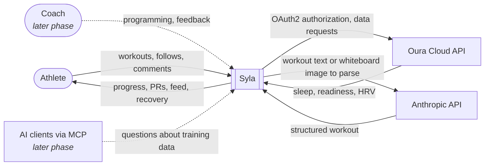

# 3. Context and Scope

## 3.1 Business Context

| Partner | Inputs to Syla | Outputs from Syla |
|---|---|---|
| Athlete | Workouts (form, free text or whiteboard photo), gym memberships, published gym classes, class attendance, follows, likes, comments, consent, Oura connection | Progress charts, PRs, benchmark history, feed, recovery next to training, data export |
| Coach (later) | Programming, feedback, approvals of AI suggestions | Athlete progress, compliance, readiness |
| Oura Cloud API | Sleep, readiness, HRV and activity summaries | OAuth2 authorization requests, data requests |
| Anthropic API | Structured workout output, agent responses | Workout text or preprocessed whiteboard images (no EXIF metadata) and context with no direct personal identifiers |
| AI clients via MCP (later) | Natural-language questions | The athlete's own training data, scoped to their consent |

## 3.2 Technical Context

| Channel | Protocol | Notes |
|---|---|---|
| Browser to Syla | HTTPS, REST/JSON | Authentication approach is still open (see section 4.3) |
| Syla to Oura | HTTPS, REST/JSON, OAuth2 authorization code flow | Webhooks vs. scheduled polling will be decided in the Oura integration ADR |
| Syla to Anthropic | HTTPS, REST/JSON | Called only from the agent service |
| AI clients to Syla (later) | MCP | Exposed only by the MCP server |

## 3.3 Out of Scope for the MVP

- Native mobile apps, Apple Health and Health Connect
- Voice input for logging (see [ADR-0009](../adr/0009-whiteboard-photo-parsing.md))
- GPS tracking and route maps
- Coach, payment and marketplace features
- Gym owner accounts, gym verification and gym programming (the MVP has only member-created gyms and classes, see [ADR-0010](../adr/0010-gym-classes-and-co-attendance.md))
- Email and push notifications
- Wearables other than Oura
