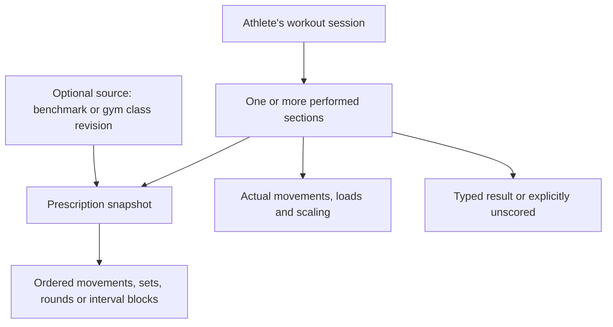

# Workout domain model

Status: Conceptual model endorsed by the user on 2026-11-04, based on the five [validated examples](#agreed-workout-examples). Explicitly unresolved choices in section 9 remain open for the logging specification. This document defines concepts and intended invariants, not a database schema, accepted ADR, or final API contract.

## 1. Central distinction

Keep what was prescribed separate from what the athlete actually did. A workout session belongs to one athlete and can contain multiple independently scored sections. A gym class is a shared prescription; it does not own athletes' results.

This is a conceptual relationship diagram. The shared class remains in the `gyms` module and is referenced by ID under ADR-0010; the snapshot and athlete result are owned by `workouts`.

## 2. Concepts

| Concept | Meaning and minimum information |
|---|---|
| Workout session | One athlete's logged training occasion: ID, owner ID, training date, time zone, optional title/notes, ordered sections, creation/update timestamps and revision |
| Performed section | One part of the session, such as strength or metcon: stable section ID, order, title, format, prescription snapshot, actual performance, score state and result |
| Prescription snapshot | The reviewed instructions associated with the attempt: ordered work, timing, rep scheme, applicable load option, and optional benchmark/class source revision |
| Movement | A stable movement identity and readable name, with aliases for input such as “T2B.” An unresolved name can remain in a draft but must be reviewed before a scored canonical comparison |
| Movement occurrence | A particular position within a prescription: the same movement can occur in several rounds with different reps or loads. Give occurrences stable local identities so substitutions are unambiguous |
| Actual performance | Completed sets or the performed movement/load configuration and any deviations from the prescription. Do not copy a prescribed load into an actual result without athlete confirmation |
| Section result | A format-specific value, such as strength sets, rounds plus reps, elapsed time, capped reps, or interval measurements |
| Source reference | Optional benchmark ID/version or class ID/revision plus source section identity. References provide provenance; editing a source never silently changes an existing attempt |

The user-facing term can remain “workout.” Internally, distinguish the session, its instructions, and the athlete's attempt. Do not introduce separate deployables or modules for these concepts.

## 3. Prescription structure

Use a closed set of supported formats with explicit structures, rather than a free-form expression language:

| Format | Prescription structure | Proposed result structure |
|---|---|---|
| Strength | Ordered sets, target reps, movement, optional load target or instruction to build | Ordered actual sets: completed reps and load |
| AMRAP | Duration and ordered repeatable round | Whole rounds plus additional work in a partial round |
| For Time | Ordered finite rounds/work; optional cap | Completed with elapsed duration, or capped with completed work |
| Tabata | Ordered blocks, movement/unit per block, work/rest durations, interval count, rest between blocks | Interval values and/or an explicitly reported block summary |
| EMOM | Reserved MVP format; exact work scheduling and result structure need a validated example | Not defined yet; do not treat it as AMRAP or Tabata |

For Fran, represent three rounds with rep targets 21, 15, and 9 for both movements. Do not store “21-15-9” as the only machine-readable prescription. For Cindy, store one ordered 5/10/15-rep round with a 20-minute duration.

Prescribed load alternatives, such as Fran's 65 lb and 95 lb options, are explicit options. The attempt selects an option; eligibility and comparisons are not inferred from a person's profile or from the display name “Fran.”

## 4. Values and validation

- Repetitions and whole rounds are nonnegative integers. Prescription set/round/interval counts and required durations are positive. Missing values are distinct from zero.
- A load is a decimal amount plus an explicit unit (`kg` or `lb` initially). Preserve the entered value/unit. Comparison conversion and rounding policy belong in the progress specification. Record load basis where relevant, such as total barbell load versus load per dumbbell; do not compare those as identical.
- Duration is stored as a numeric time value with defined precision in the eventual API; display `7:42` is not the source of truth. For the examples, completed Fran is 462 seconds; the synthetic cap is 600 seconds.
- Counts, calories, and distances retain explicit units. Initially compute a flat AMRAP rep total only when the round consists of countable reps. Mixed meters/calories/reps need an explicit scoring rule before support; do not add unlike units.
- For a fixed 30-rep Cindy round, additional reps range from 0 to 29. Normalize a full extra round into the whole-round count. Thus `12 + 8` means 368 reps, not 12.8 rounds.
- A completed For Time result has elapsed duration. A capped result has the cap and completed work; it has no completed-workout time. Reject a capped result claiming all required work was completed. Early stopping before the cap needs a separate rule; do not silently call it capped.
- No overall numeric score is proposed for a mixed session. Each section retains its own result and units.
- Store the athlete's training date and the relevant IANA time zone explicitly, with UTC timestamps for record creation/update. Do not derive historical training dates from the viewer's current zone. An exact start instant is optional when an athlete logs only a date.

## 5. Scoring state and scaling

Proposed scoring state: `scored` with a valid typed result, or `unscored` with no result. A performed section can be unscored when the athlete trained but did not record a score. A section not performed is omitted from the athlete's session; preserve source-section references rather than inserting zero results. An unsaved form is not automatically a stored workout.

Proposed prescription status: `rx`, `scaled`, or `unspecified`. RX is relative to the selected prescription option, not a universal claim. Use `unspecified` when it is not asserted, including strength work without an RX prescription. A known deviation cannot be marked RX. Keep actual substitutions, loads, rep changes, and duration changes as structured information where supported; optional notes add context but do not replace those fields.

For these examples, use one performed configuration throughout an AMRAP/For Time section. A mid-workout change such as switching from pull-ups to ring rows after round five needs additional modeling; do not silently apply the last configuration to every round. Recording such a session unscored with notes can be considered in the feature specification.

### Tabata detail versus reported summaries

The validated W4 contains minimum scores without the eight underlying values. Proposed support: distinguish `interval_detail` from `reported_summary` so an athlete can log the known minimum without inventing interval data. This is a proposed convenience, not previously approved behavior.

When all eight values are supplied, derive the minimum and reject an inconsistent accompanying summary. When only a reported summary exists, display it as reported and do not claim interval completeness. Partial interval data must not be treated as a verified minimum across all eight intervals. Rowing remains calories; other W4 blocks remain reps. Overall benchmark aggregation is still open.

## 6. Mapping the approved examples

| Example | Session/section representation | Result and distinctions |
|---|---|---|
| W1 | One session, one strength section with five target sets | Five actual sets with loads 50/55/60/62.5/65 kg. The final-set variation stores 3 actual reps against 5 target reps |
| W2 | One session, one 20-minute AMRAP section with a 30-rep round | RX: 12 rounds + 8 reps. Scaled variation records ring rows and 14 + 3 (423 reps), preserving the original pull-up prescription |
| W3 | One session, one For Time section; selected 65 lb load option | Completed: 462 seconds. Separate capped variation: 600-second cap and 81 of 90 reps, including all final thrusters and none of the final pull-ups |
| W4 | One session, one Tabata section with five ordered blocks | Reported block minima 5 calories / 14 / 4 / 6 / 10 reps, with no fabricated interval arrays. Interval-detail mode is a separate fixture to add |
| W5 | One session, strength section plus 10-minute AMRAP section | Strength as W1; metcon 6 + 12 (192 reps) with ring rows. Log Part A alone by omitting Part B, not by creating a zero score |

The W5 shortened prescription is a variant, not a new standard 20-minute Cindy record. A display name or source link alone cannot establish benchmark equivalence.

## 7. Ownership and lifecycle

- Derive owner ID from authenticated identity, never trust a submitted owner ID. Workout operations and exports check ownership in the core API. Wider audience policies remain the separate authorization specification.
- Save one session and its included sections atomically inside `workouts`. Use an explicit request idempotency mechanism for retries; similar content on the same day is not proof of duplication because an athlete can repeat a workout.
- On edit, validate the complete affected section, increment the record revision, and signal changes for derived progress. Use revision checks to prevent one browser overwriting another's edits. Event envelopes and publication guarantees need the runtime design before code.
- On delete, remove/invalidate derived progress and references through module APIs/events. Account deletion must also handle pending events; this model alone does not define that orchestration.
- A class edit preserves old snapshots. Two attempts against different revisions are not automatically comparable. Saving personal results never edits the shared class.
- Parser output is a proposed prescription with unresolved fields flagged. It is not an athlete result or saved session until the athlete selects sections, reviews values, and confirms. No raw photo belongs in this model.

## 8. Persistence and contracts

Follow ADR-0004: relational fields for stable identities, ownership, dates, format, revision, and fields used in queries; validated JSONB can hold format-specific structures. Final tables, indexes, JSON schema/versioning, payload limits, and mapping of set/result details must be designed with the first feature. No cross-module foreign keys or SQL joins.

Core domain types should make invalid result combinations impossible. OpenAPI owns the API contract; generated clients and Python boundary schemas must align with it. This conceptual model is not a reason to hand-copy service contracts or create all future tables now.

## 9. Next decisions and first-slice recommendation

Approved M1 format boundary: strength, AMRAP, and For Time, initially one section per saved session. W1–W3 supply the examples; detailed completed/capped validation remains in the draft specification. Keep the conceptual section boundary so W5 can extend it in M2. Tabata and mixed sessions join M2 as already planned; EMOM requires its own validated example. The full MVP scope is unchanged.

Product choices to resolve in the logging specification:

1. Resolved on 2026-11-04: M1 formats and one-section boundary approved; performed-but-unscored logging is included. Private history and today/past training dates were also approved.
2. Decide whether Tabata allows reported summaries without interval detail; recommendation: yes, explicitly labeled.
3. Define early-stopped For Time attempts and mid-workout scaling changes before supporting those scored cases.

Benchmark equivalence, ranking, estimation formulas, and kg/lb comparison tolerance belong to later progress/gym specifications. They must not be silently inferred from this draft. Authentication and initial privacy workflows remain prerequisites to implementing M1.

# Agreed workout examples

Status: validated as representative by the user on 2026-11-04. All athlete results below are fictional test data. Approval covers the examples; it does not settle the complete domain schema, ranking policy, or first-milestone scope.

These examples are development fixtures. Use them when specifying manual logging, parser output, class templates, and progress. Source workouts are linked; synthetic variations are explicitly identified.

See the [workout model](#workout-domain-model) for how these examples map to sessions, sections, prescriptions, and results. The user endorsed the conceptual model; explicitly unresolved specification choices remain open.

## W1 — Strength: back squat

Source: [CrossFit workout 260619](https://www.crossfit.com/260619).

Prescription: five sets of five back squats.

| Set | Actual reps | Load |
|---|---|---|
| 1 | 5 | 50 kg |
| 2 | 5 | 55 kg |
| 3 | 5 | 60 kg |
| 4 | 5 | 62.5 kg |
| 5 | 5 | 65 kg |

Variation: only three reps completed in the final set. Preserve the prescribed five reps separately from the actual three; do not count it as a completed five-rep set.

Expected capture: ordered sets, actual reps, decimal load, explicit units, and optional notes. Do not infer a universal RX load for this strength workout.

## W2 — AMRAP: Cindy

Source: [CrossFit Cindy](https://www.crossfit.com/benchmark/cindy).

Prescription: repeat 5 pull-ups, 10 push-ups, and 15 air squats for 20 minutes.

Example result: 12 complete rounds plus 8 additional reps, RX. The additional reps mean 5 pull-ups and 3 push-ups; total completed reps are 368.

Synthetic scaled variation: same duration and rep scheme, replacing pull-ups with ring rows; result is 14 rounds plus 3 reps. Record the performed substitution and scaled status, not just a free-text label. Keep it distinguishable from RX for later comparisons.

Expected capture: time limit, ordered movements and reps, complete rounds, additional reps, and performed scaling.

## W3 — For Time: Fran

Source: [CrossFit Fran](https://www.crossfit.com/benchmark/fran).

Prescription: 21, then 15, then 9 reps of thrusters and pull-ups. The source lists prescribed thruster loads of 65 lb and 95 lb; the example uses the 65 lb prescription.

Example result: completed in 7 minutes 42 seconds at 65 lb, RX for that prescription.

Synthetic gym variation: add a 10-minute time cap. Athlete completes 81 of 90 total reps: the 21 and 15 rounds, then 9 thrusters, with the final pull-ups unfinished.

Expected capture: completed duration versus capped/incomplete status, completed reps for the capped attempt, actual load/unit, and prescription identity. The added cap is a gym variation, not part of the cited official prescription. Do not display an incomplete attempt as a completed 10-minute Fran.

## W4 — Intervals: Tabata This!

Source: [CrossFit Tabata This!](https://www.crossfit.com/benchmark/tabata-this).

Prescription: rowing, squats, pull-ups, push-ups, and sit-ups in separate blocks, with one minute of rest between blocks. Each block has eight intervals of 20 seconds of work and 10 seconds of rest. Each movement's score is its lowest interval result; rowing is measured in calories.

Fictional minimum scores:

| Block | Minimum interval result |
|---|---|
| Row | 5 calories |
| Squat | 14 reps |
| Pull-up | 4 reps |
| Push-up | 6 reps |
| Sit-up | 10 reps |

Expected capture: per-interval values, explicit units, work/rest timing, and calculated minimum for each block. The minimum scores alone are illustrative summaries, not a complete interval-level fixture. Exact eight-interval arrays and any overall aggregation rule remain to be specified; do not fabricate missing intervals from the minima.

## W5 — Mixed strength and conditioning session

Constructed test session combining W1 with a shortened W2; this combination is not an official benchmark.

- Part A: five sets of five back squats; results as in W1.
- Part B: 10-minute Cindy variation; result 6 rounds plus 12 reps, using ring rows in place of pull-ups.

Expected capture: one session with independently scored sections. Part B retains its changed duration and substitution and must not be treated as an RX 20-minute Cindy benchmark. The athlete can select and log only the section performed; an unperformed section must not be recorded as a zero score.

## Coverage and remaining specification work

| Concern | Examples |
|---|---|
| Decimal loads and per-set performance | W1 |
| Rounds plus partial round | W2, W5 |
| Movement substitutions | W2, W5 |
| Completed versus capped score | W3 |
| Units and interval aggregation | W4 |
| Multiple sections and partial participation | W5 |

EMOM is still MVP scope but has no validated example yet. These five examples are a starting fixture set, not the parser's full evaluation dataset. Validation errors, date/time behavior, kg/lb conversion, benchmark equivalence, ties, and interval-level data still need feature specifications. The first slice supports strength, AMRAP, and For Time.
